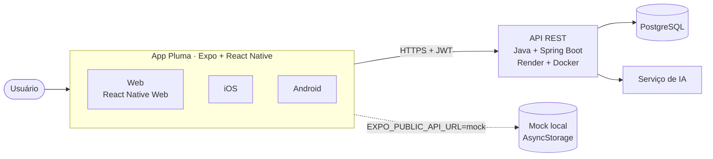
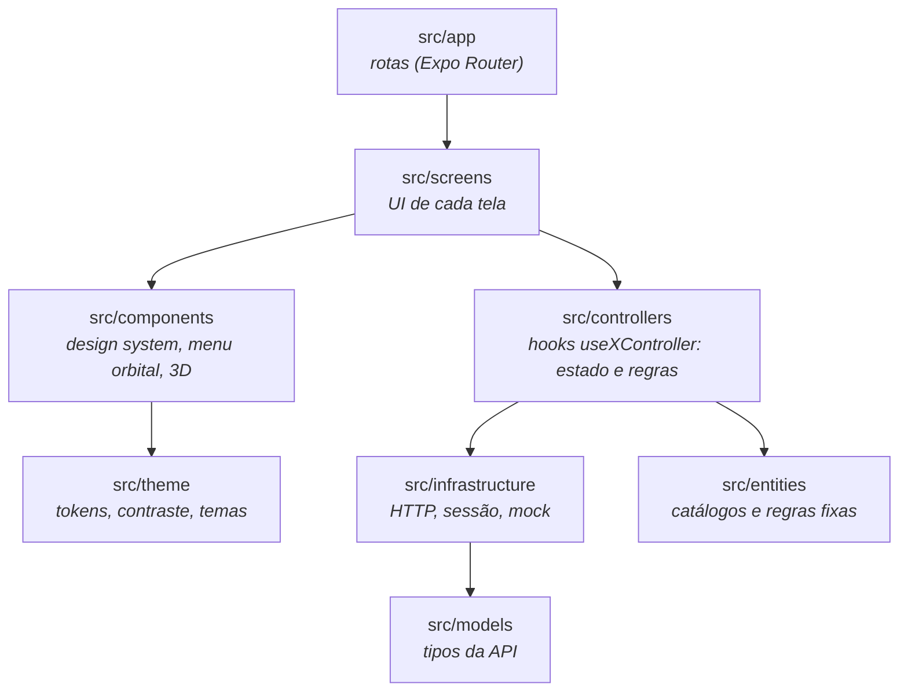
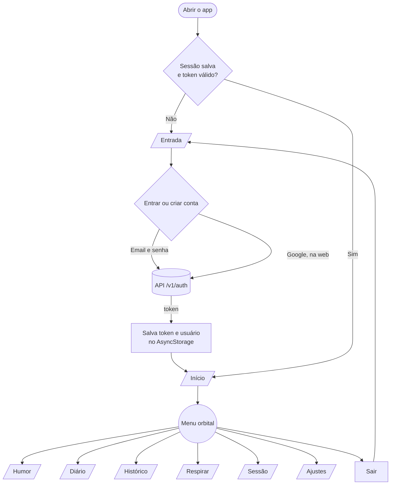
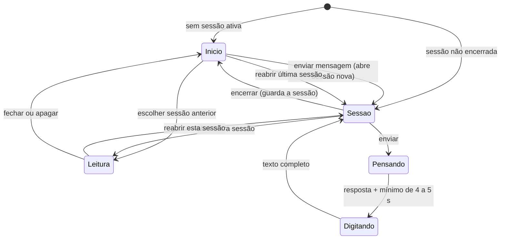
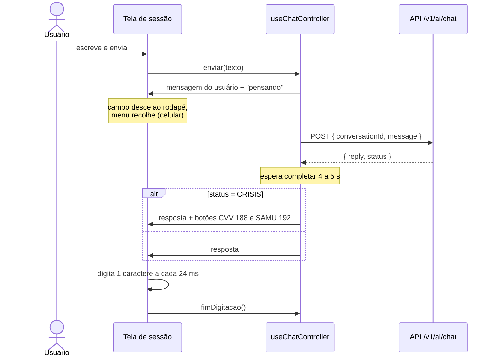
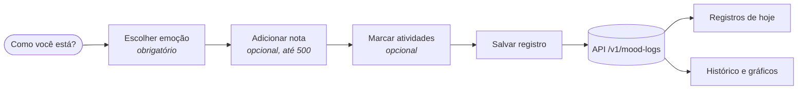

<div align="center">


# Pluma

**Um momento de calma, a um toque de distância.**

Aplicativo de apoio emocional e bem-estar para web, iOS e Android.
Registre o humor, escreva no diário, respire com um exercício guiado e converse com a Pluma em sessões guardadas só para você.

[](https://expo.dev)
[](https://reactnative.dev)
[](https://react.dev)
[](https://www.typescriptlang.org)
[](https://docs.expo.dev/router/introduction/)
[](https://docs.swmansion.com/react-native-reanimated/)
[](https://threejs.org)
[](https://jestjs.io)
[](https://playwright.dev)

[Aplicação](https://projetopluma.vercel.app) · [Back-end](https://github.com/projetovivaleve-5org/back-end_vivaleve) · [Política de privacidade](https://policy-private-pluma.vercel.app/)

</div>

> [!IMPORTANT]
> A Pluma é uma ferramenta de apoio e **não substitui** acompanhamento profissional. Em caso de crise, ligue para o **CVV: 188** (24 horas, gratuito) ou para o **SAMU: 192**.

---

## Sumário

- [Sobre o projeto](#sobre-o-projeto)
- [Demonstração](#demonstração)
- [Telas](#telas)
- [Funcionalidades](#funcionalidades)
- [Tecnologias](#tecnologias)
- [Arquitetura](#arquitetura)
- [Fluxos](#fluxos)
- [Como rodar](#como-rodar)
- [Testes](#testes)
- [Estrutura de pastas](#estrutura-de-pastas)
- [Design e acessibilidade](#design-e-acessibilidade)
- [Deploy](#deploy)
- [Equipe](#equipe)

---

## Sobre o projeto

Cuidar da saúde mental começa por algo básico: **notar o que se sente**. Na correria do dia a dia isso fica difícil: parar para entender o próprio humor exige esforço, muitos apps de bem-estar são complexos ou parecem mais uma tarefa, e quando a pessoa precisa de ajuda de verdade nem sempre sabe para onde ir.

A Pluma reúne, em um só lugar e sem complicação, o essencial do autocuidado diário:

1. **Registrar o humor** em poucos segundos.
2. **Escrever no diário** o que está na cabeça.
3. **Acompanhar o histórico** e perceber padrões.
4. **Respirar** com um exercício guiado quando a ansiedade apertar.
5. **Conversar com a Pluma** em sessões que ficam guardadas e podem ser retomadas.
6. **Encontrar ajuda profissional** com acesso direto à rede de apoio.

**Princípios:** simplicidade real, acessibilidade como requisito, responsabilidade (a Pluma não diagnostica e sempre indica ajuda especializada) e privacidade no tratamento de dados sensíveis.

---

## Demonstração

<table>
  <tr>
    <th>Sessão com a Pluma</th>
    <th>Menu orbital</th>
    <th>Menu recolhido na sessão</th>
  </tr>
  <tr>
    <td></td>
    <td></td>
    <td></td>
  </tr>
  <tr>
    <td>O campo sai do centro e desce para o rodapé; a Pluma "pensa" por 4 a 5 s e digita a resposta em ritmo fixo.</td>
    <td>A bolinha da pluma abre uma roda com todos os destinos, sobre a tela desfocada.</td>
    <td>Durante a sessão, no celular, a bolinha afunda e fica só uma alça, que abre o menu direto.</td>
  </tr>
  <tr>
    <th>Abertura do dia</th>
    <th>Respiração guiada 3-4-5</th>
    <th>Diário</th>
  </tr>
  <tr>
    <td></td>
    <td></td>
    <td></td>
  </tr>
  <tr>
    <td>A tela inicial abre com o sol ou a lua do momento do dia.</td>
    <td>Inspire 3 s, segure 4 s, expire 5 s, acompanhando o mascote.</td>
    <td>Anotações em post-its presos por tachinha e ligados por barbante.</td>
  </tr>
</table>

---

## Telas

Capturas geradas com Playwright a partir do build web, com a API em modo mock.

### Celular

| Entrada | Início | Humor | Diário |
|:---:|:---:|:---:|:---:|
|  |  |  |  |

| Histórico | Respirar | Ajustes | Sessão |
|:---:|:---:|:---:|:---:|
|  |  |  |  |

| Sessão em andamento | Sessões anteriores | Sessão finalizada | Tema escuro |
|:---:|:---:|:---:|:---:|
|  |  |  |  |

<details>
<summary><strong>Mais telas no tema escuro</strong></summary>

| Início | Diário | Sessão |
|:---:|:---:|:---:|
|  |  |  |

</details>

### Desktop

| Início | Sessão |
|:---:|:---:|
|  |  |

<details>
<summary><strong>Todas as telas no desktop</strong></summary>

| Entrada | Humor |
|:---:|:---:|
|  |  |

| Diário | Histórico |
|:---:|:---:|
|  |  |

| Respirar | Ajustes |
|:---:|:---:|
|  |  |

| Sessão em andamento | Sessão finalizada |
|:---:|:---:|
|  |  |

</details>

---

## Funcionalidades

| Módulo | Rota | O que faz |
|---|---|---|
| **Entrada** | `/login` | Login e cadastro por email e senha (8 a 64 caracteres) e login com Google na web. |
| **Início** | `/` | Saudação do momento do dia, registro rápido de humor, atalho para respirar e rede de apoio (CVV 188, psicólogos, terapia online). |
| **Humor** | `/humor` | Seis emoções, atividades do dia e nota opcional, com os registros de hoje. |
| **Diário** | `/diario` | Mural de post-its e calendário; criar, editar, buscar e excluir anotações, com emoção associada. |
| **Histórico** | `/historico` | Evolução do humor em 7 ou 30 dias, distribuição, emoção predominante e sequências de registro. |
| **Respirar** | `/respirar` | Exercício guiado 3-4-5 com ciclos, registro de sessões e estatísticas. |
| **Sessão** | `/chat` | Conversa com a IA em sessões: início centralizado, reabrir a última sessão, sessões anteriores para ler ou retomar e aviso de crise com CVV e SAMU. |
| **Ajustes** | `/config` | Usuário, tema claro/escuro/sistema, sons ambiente, links úteis, apagar dados e sair. |

---

## Tecnologias

| Camada | Tecnologia | Versão | Uso |
|---|---|---|---|
| Plataforma | [Expo](https://expo.dev) | SDK 58 | Build e execução em web, iOS e Android |
| UI | [React Native](https://reactnative.dev) + [React](https://react.dev) | 0.88 / 19.3 | Componentes de interface |
| Web | [React Native Web](https://necolas.github.io/react-native-web/) | 0.21 | Mesmo código rodando no navegador |
| Linguagem | [TypeScript](https://www.typescriptlang.org) | 6.0 | Tipagem estática |
| Navegação | [Expo Router](https://docs.expo.dev/router/introduction/) | 58 | Rotas por arquivo em `src/app` |
| Animação | [Reanimated](https://docs.swmansion.com/react-native-reanimated/) + [Moti](https://moti.fyi) | 4.7 / 0.30 | Transições, menu orbital e animações da sessão |
| 3D | [Three.js](https://threejs.org) + [React Three Fiber](https://r3f.docs.pmnd.rs) | 0.187 / 9.8 | Cenas e ícones 3D |
| Ícones | [Lucide](https://lucide.dev) | 1.74 | Ícones de traço |
| Armazenamento | [AsyncStorage](https://react-native-async-storage.github.io/async-storage/) | 2.2 | Sessão do usuário e banco do modo mock |
| Áudio | [expo-audio](https://docs.expo.dev/versions/latest/sdk/audio/) | 58 | Sons ambiente |
| Testes | [Jest](https://jestjs.io) + [Testing Library](https://callstack.github.io/react-native-testing-library/) | 30 / 14 | Testes de unidade, controllers e telas |
| E2E | [Playwright](https://playwright.dev) + [axe-core](https://github.com/dequelabs/axe-core) | 1.65 / 4.14 | Fluxos, screenshots e acessibilidade |
| Qualidade | [ESLint](https://eslint.org) (`eslint-config-expo`) | 9 | Lint |
| Back-end | Java + Spring Boot, PostgreSQL | — | API REST ([repositório](https://github.com/projetovivaleve-5org/back-end_vivaleve)) |

---

## Arquitetura

### Visão geral



### Camadas do app

Cada camada só importa a de baixo. A tela nunca fala direto com a API: ela desenha, o controller decide e a infraestrutura conversa com fora.



Contratos completos em [`app/ARCHITECTURE.md`](app/ARCHITECTURE.md).

---

## Fluxos

### Autenticação e navegação



### Sessão com a Pluma



### Envio de mensagem



### Registro de humor



---

## Como rodar

### Pré-requisitos

- [Node.js](https://nodejs.org) LTS e npm
- Para celular: app [Expo Go](https://expo.dev/go) ou um build de desenvolvimento (`npx expo run:ios` / `npx expo run:android`)

### Instalação

```bash
git clone https://github.com/lfzorzetti-eng/FrontEnd-VivaLeve.git
cd FrontEnd-VivaLeve/app
npm install
npx expo start
```

No terminal do Expo: `w` abre na web, `i` no simulador iOS, `a` no emulador Android, ou leia o QR code com o Expo Go.

### Variáveis de ambiente

| Variável | Valores | Padrão |
|---|---|---|
| `EXPO_PUBLIC_API_URL` | `mock` ou a URL da API | `mock` em desenvolvimento; `https://back-end-vivaleve.onrender.com` em produção |
| `EXPO_PUBLIC_GOOGLE_CLIENT_ID` | Client ID OAuth do Google (web) | o client ID do projeto |

O modo **mock** roda sem back-end: guarda os dados no próprio dispositivo e já vem com dados de exemplo (humor, diário, respiração e duas sessões anteriores).

**Usuário de teste (só no modo mock):** na tela de login, toque em **Entrar com usuário de teste**, ou entre com `teste@pluma.dev` e senha `12345678`. Ele é o dono dos dados de exemplo; qualquer outro email também entra, mas começa vazio.

```bash
EXPO_PUBLIC_API_URL=mock npx expo start
EXPO_PUBLIC_API_URL=https://back-end-vivaleve.onrender.com npx expo start
```

### Scripts

| Comando | O que faz |
|---|---|
| `npm start` | Servidor de desenvolvimento do Expo |
| `npm run web` | Abre direto na web |
| `npm run ios` / `npm run android` | Build de desenvolvimento nativo |
| `npm test` | Testes Jest |
| `npm run lint` | ESLint |
| `npx tsc --noEmit` | Verificação de tipos |
| `npx playwright test` | Testes E2E (gera o build web com API mock) |

---

## Testes

| Tipo | Ferramenta | Onde | O que cobre |
|---|---|---|---|
| Unidade e telas | Jest + Testing Library | `app/src/**/__tests__` | Controllers, regras, mock da API, telas e contraste do tema |
| Piso visual | Jest | `app/src/__tests__/visual-slop.test.ts` | Bloqueia cor, sombra, fonte e gradiente fora dos tokens do tema |
| E2E | Playwright | `app/e2e` | Fluxos principais e screenshots em celular e desktop, claro e escuro |
| Acessibilidade | Playwright + axe-core | `app/e2e/a11y.spec.ts`, `contraste.spec.ts` | Regras WCAG e contraste medido |

```bash
cd app
npm test
npx playwright test
npx playwright test --update-snapshots   # depois de mudança visual intencional
```

---

## Estrutura de pastas

```text
FrontEnd-VivaLeve/
├── app/                      # App Expo + React Native
│   ├── src/
│   │   ├── app/              # Rotas (Expo Router)
│   │   ├── screens/          # Telas: login, home, humor, diario, historico, respirar, chat, config
│   │   ├── controllers/      # Hooks de estado e regra de cada tela
│   │   ├── infrastructure/   # HTTP, sessão, recursos da API e mock
│   │   ├── models/           # Tipos da API
│   │   ├── entities/         # Catálogos fixos (emoções, atividades, frases, ritmo da sessão)
│   │   ├── components/       # Design system, menu orbital e cenas 3D
│   │   └── theme/            # Tokens, temas claro/escuro e contraste
│   ├── e2e/                  # Testes Playwright
│   ├── docs/VISUAL.md        # Guia visual
│   ├── ARCHITECTURE.md       # Camadas e contratos
│   └── LAYOUT.md             # Grade e larguras
└── docs/readme/              # Imagens e animações deste README
```

---

## Design e acessibilidade

- Interface inspirada nos apps **Saúde** e **Ajustes** do iOS: fonte do sistema, listas agrupadas e uma única cor de destaque (verde sálvia).
- Temas **claro e escuro**, com contraste mínimo de 4,5:1 para texto, verificado em teste.
- Respeita **"Reduzir movimento"**: as animações viram transições instantâneas.
- Alvos de toque de pelo menos 44 pt e rótulos de acessibilidade em todos os controles.
- Regras completas em [`app/docs/VISUAL.md`](app/docs/VISUAL.md).

---

## Deploy

A versão web é um build estático:

```bash
cd app
npx expo export -p web     # gera app/dist
```

Publique a pasta `app/dist` em qualquer hospedagem estática (por exemplo, Vercel), com fallback das rotas para `index.html`. Para iOS e Android, use o [EAS Build](https://docs.expo.dev/build/introduction/).

---

## Equipe

Projeto desenvolvido por estudantes, com foco em acessibilidade, bem-estar e interação do usuário.

- [Tsukiii3](https://github.com/Tsukiii3)
- [lfzorzetti-eng](https://github.com/lfzorzetti-eng)
- [gustavobferrao](https://github.com/gustavobferrao)
- [Igorrmoura](https://github.com/Igorrmoura)
- [Leo-Porte](https://github.com/Leo-Porte)
